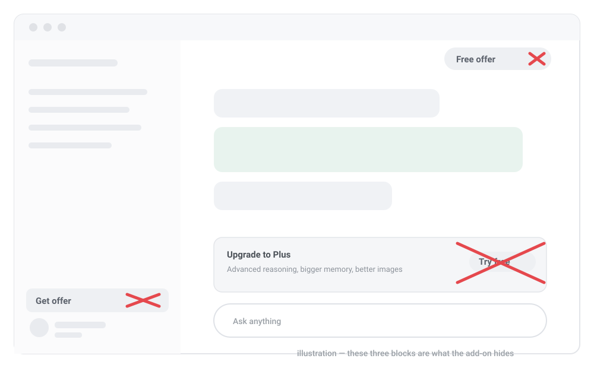

# ChatGPT Ad Cleaner

A small browser add-on that hides the upgrade ads on **chatgpt.com**.

It runs quietly in the background. You don't need to configure anything.

It works whatever language your ChatGPT is set to: the ad blocks are found by where they sit on the page, not by the words inside them, and the buttons are recognised in English, Chinese, Spanish, French, German, Portuguese, Italian, Japanese, Korean, Russian and more.

<p align="center">
  
</p>

<p align="center"><em>Illustration — these three blocks are what the add-on hides.</em></p>

---

## What it hides

| What you see on the page | What happens after installing |
| --- | --- |
| The **"Get offer"** button at the bottom of the left sidebar | Gone |
| The **"Free offer"** button in the top-right corner | Gone |
| The small **"Free"** word under your name | Gone |
| The **"ChatGPT can make mistakes. Check important info."** line under the chat | Gone |
| The upgrade card above the message box ("Upgrade to Plus …" + "Try Plus free") | Gone |
| The **"Get Plus for more uploads / or wait 18 hours"** row in the **+** menu | Gone, and **"Upload from computer"** comes back |
| The small plan reminder pill in the top bar (with its **×** button) | Gone |

Everything else stays exactly the same: your chats, the message box, the sidebar, sending and receiving messages.

---

## Also: turns "Think" on for you

Free accounts have a **Think** button in the message box, and every new chat starts with it switched off.

The add-on switches it on automatically, so your first message already uses the slower, more careful reasoning mode.

If you turn it off yourself, it stays off for that chat — the script only sets it once.

---

## Install (about 2 minutes)

**Step 1.** Install the browser extension that runs these small scripts.

| Browser | Link |
| --- | --- |
| Chrome / Edge / Brave / Opera | [Tampermonkey](https://chromewebstore.google.com/detail/tampermonkey/dhdgffkkebhmkfjojejmpbldmpobfkfo) |
| Firefox | [Tampermonkey](https://addons.mozilla.org/firefox/addon/tampermonkey/) |
| Safari | [Tampermonkey](https://apps.apple.com/app/tampermonkey/id1482490089) |

**Step 2.** Click the button below.

### ➡️ [Install ChatGPT Ad Cleaner](https://raw.githubusercontent.com/free6589/chatgpt-ad-cleaner/main/chatgpt-ad-cleaner.user.js)

**Step 3.** Tampermonkey opens a page that shows the script. Click **Install**.

**Step 4.** Open or refresh [chatgpt.com](https://chatgpt.com). The ads are gone.

That's it. Nothing else to set up.

---

## How do I know it is working?

Open ChatGPT and look at the bottom-left corner. The **"Get offer"** button should be gone.

If you want to be sure the script is loaded, press `F12`, open the **Console** tab and type:

```js
document.documentElement.dataset.chgptScript
```

It should print the version number, for example `"2.2.0"`.

---

## Questions

**Will this break my chats?**
No. The script only hides advertisement blocks. It never touches the messages, the message box or the sidebar, and it is tested on real conversations.

**The ads are still there. What now?**
1. Check that Tampermonkey is turned on.
2. Check that the script is enabled in the Tampermonkey dashboard.
3. Refresh the page with `Ctrl + F5` (or `Cmd + Shift + R` on a Mac).
4. Make sure the version shown in the console is the latest one.

If one specific ad is still visible, please [open an issue](https://github.com/free6589/chatgpt-ad-cleaner/issues) and paste the text of that ad. It is usually a new design that needs one more rule.

**It says I reached the file upload limit. Can this script remove that?**
Partly. The script puts the normal **"Upload from computer"** item back in the **+** menu, so you are not shown the upgrade row instead. But the upload limit itself is counted on OpenAI's servers. No browser script can change that number — you have to wait for the timer to run out, or upgrade your plan.

**How do I uninstall it?**
Open the Tampermonkey dashboard, find **ChatGPT Ad Cleaner** and click **Delete**. ChatGPT goes back to normal immediately.

**My ChatGPT is not in English. Does it still work?**
Yes. The big blocks — the offer button in the sidebar, the plan badge under your name, the upgrade card above the message box and the reminder in the top bar — are found by their position on the page, so their wording does not matter. The buttons themselves are also recognised in many languages, not only English.

**Will it make ChatGPT slower?**
No. It only looks at the parts of the page that changed, and it skips the reply text completely while an answer is being written. One check takes about a millisecond.

If a page ever feels heavy anyway, open the console and run `__chgptCleaner.pause()` to stop it, or `__chgptCleaner.resume()` to start it again.

**Does it collect any data?**
No. The script has no network requests of its own, no analytics and no tracking. It only changes what is displayed in your own browser.

---

## Files

- `chatgpt-ad-cleaner.user.js` — the script itself
- `docs/index.html` — a one-page install site (GitHub Pages)

## License

MIT. See [LICENSE](LICENSE).
